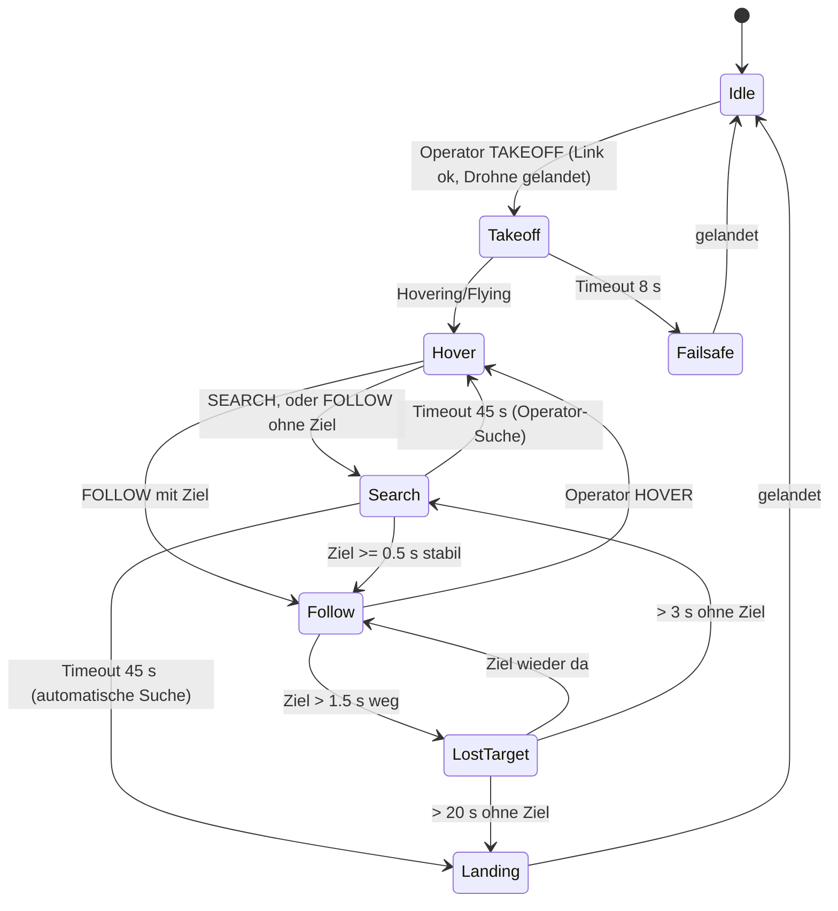

# DroneFollow – Verhaltens-State-Machine

`BehaviourMachine` (`Assets/Scripts/Behaviour/`) ist die einzige Instanz, die entscheidet, was die Drohne tut. Die Policy (PPO)
liefert nur einen Vorschlag und wird ausschließlich im Zustand **Follow** durchgereicht. Die Logik ist reines C# (Zeit kommt als `dt`),
läuft identisch im Simulator und auf der echten AR.Drone und ist per EditMode-Tests abgedeckt.



Aus jedem Flugzustand: Operator **LAND** → Landing. **Failsafe** bei Link-Verlust > 1 s, echter App-Pause (nicht der REC-Dialog),
Akku (siehe unten) oder Takeoff-Timeout. Drohnen-`Emergency` → Idle (Motoren aus).

## Parameter (`BehaviourSettings`)
| Name | Start | Bedeutung |
|---|---|---|
| followLostSeconds | 1.5 | Follow → LostTarget |
| lostToSearchSeconds / lostToLandSeconds | 3 / 20 | Gesamtzeit ohne Ziel |
| acquireSeconds | 0.5 | Ziel muss so lange durchgehend sichtbar sein |
| searchYaw | 0.35 | Drehrate in Search (≈ 35 °/s, eine Runde ≈ 10 s) |
| searchClimb / searchClimbSeconds | 0.3 / 1.4 | Steigschritt (~0.3 m) nach jeder Runde |
| searchMaxAltitude / maxAltitude | 2.0 / 2.5 m | Höhenlimits |
| searchTimeoutSeconds | 45 | Suchzeitlimit |
| landBelowBatteryPercent | 12 | Akku-Grenze |
| batteryWindowSeconds / batteryDebounceSeconds | 5 / 2 | siehe unten |

## Akku
Der AR.Drone-Prozentwert bricht unter Last stark ein (100 → 58 % im Flug, danach wieder 86 %). Verwendet wird deshalb das **Maximum der
letzten 5 s**; erst wenn auch dieses 2 s lang unter der Grenze liegt, landet die Drohne. Ein kurzer Spannungseinbruch löst nichts aus.

## Shadow-Modus
Die Machine läuft komplett, der Adapter (`DroneBehaviour`) sendet aber keine Move-Befehle (Hover). Takeoff/Land bleiben möglich.

## Zwilling
`DroneFollowInference.unity` führt Policy + Machine auf dem `SimulatedDroneController` aus, mit echtem YOLO/OSNet/MiDaS auf dem gerenderten
Bild. Grenzen: kein Akku-Sag, keine Funkprobleme, kein Optical-Flow-Drift (nur über Test-Hooks einspeisbar).

## Inference-Testszene: Bedienung und Befunde
Erzeugen: Menü `DroneDetect > Create Inference Test Scene` (kopiert `Agent1.unity` nach `Assets/Scenes/DroneFollowInference.unity`,
setzt Deployment-Modus, `InferenceOnly` mit `Assets/Models/DroneFollow.onnx`, `DroneBehaviour`, `InferenceTestRig`).
Manuell: Play, Hotkeys T/S/F/H/L oder Buttons, unten Szenario-Buttons. Unbeaufsichtigt (braucht GPU, kein `-nographics`):

```
Unity -batchmode -projectPath . -executeMethod DroneFollowInferenceSetup.CreateAndRun -scenario all -logFile Logs/inference.log
```
Exit-Code 0 = alle Szenarien bestanden. Szenarien: 1 Ziel voraus (läuft), 2 Ziel hinten (Search), 3 Ziel verschwindet
(LostTarget → Search → Landing → Idle), 4 Akku leer, 4b kurzer Akku-Einbruch, 5 Link weg, 6 stehendes Ziel.

Befunde aus den Läufen (Stand der Erstellung):
- Szenarien 2–6 bestehen. Szenario 3 erzwingt den Zielverlust per `DroneBehaviour.forceTargetLost`, weil YOLO/Re-ID im Sim nach
  Verschwinden des Ziels Fehltreffer (andere „Personen“ in der Szenerie) wieder als Ziel akzeptiert (Szenerie liefert bis zu 7 Personen).
- Szenario 1 schlägt fehl (Befund, kein Testfehler): bei einem mit 0.8 m/s laufenden Ziel wächst die Distanz von ~4 m auf 18–24 m in
  25 s; die Policy holt das Ziel nicht ein, auch wenn die Machine im Follow bleibt (`followLostSeconds` 4 s getestet).
- Aufgefunden und behoben: zufällige Einzeldetektionen setzten die Lost-Uhr zurück (Follow lebte 90 s ohne Ziel); jetzt reicht nur eine
  Sichtung ≥ `lostResetSeconds` (0.25 s). Follow startet mit leerer Lost-Uhr.

## Tests
`Assets/Editor/Tests/BehaviourMachineTests.cs` (EditMode): `Unity -batchmode -runTests -testPlatform EditMode -projectPath .`
